# 条形动画工作台

把一串按时间排列的数字变成会重排的横向条形图，再录成视频。数据在 `config/*.json` 里，页面只负责读它。



线上版：<https://lithum-12.github.io/bar-race-studio/>
需要桌面版 Chrome 或 Edge 才能导出视频；不支持 webm 编码的浏览器会退到 mp4。

## 换数据

编辑 `config/` 下任意一个 JSON，存盘即生效（本地服务模式下页面会自己重读）。

```json
{
  "$schema": "./chart.schema.json",
  "title": "虚拟品牌月度销量排行",
  "unit": "万辆",
  "time": { "granularity": "month", "start": "2024-01", "decimals": 1 },
  "series": [
    { "name": "云帆汽车", "values": [8.6, 9.1, 9.2, 9.8, 10.1] },
    { "name": "磐石汽车", "values": [null, null, null, 28.6, 28.5] }
  ],
  "events": [{ "period": "2024-04", "text": "磐石新车型上市，开始放量" }]
}
```

`values` 按 `time.granularity` 的周期依次填，各条目长度可以不一致（短的按最后一个值续，页面会提示）。填 `null` 表示该周期不在场：开头一段 `null` 是中途加入，条形从底部滑入；结尾一段是退出，条形淡出。`color` 和 `icon` 可以省略，省略时按配色方案自动分配颜色并生成圆牌徽标。

`$schema` 那行让 VS Code 给出补全和类型提示，删掉不影响运行。

## 本地跑

```
node tools/serve.mjs          # http://localhost:5278，改 JSON 存盘即热更新
node tools/build.mjs          # 产出 dist/index.html
node tools/check.mjs          # 无头渲染校验，57 条断言
node tools/banner.mjs         # 重新生成上面那张 banner
```

拆成多文件是为了能读，代价是 `file://` 下浏览器禁止加载 module 和 fetch 本地文件——直接双击源码里的 `index.html` 会白屏。所以发布版由 `build.mjs` 把 13 个模块、样式和全部数据集内联成一个文件，双击可跑；那种情况下配置只能靠「导入配置」选文件或把 JSON 拖到画布上。

两种模式的区别体现在按钮上：本地服务显示「写回文件」，直接打开文件显示「下载配置」。页面上的调整即时生效但**不会自动落盘**，配置文件是唯一真相——不然你改了 JSON 却发现页面纹丝不动，那比多一次点击麻烦得多。

## 导出

导出分辨率、帧率、码率、格式都在显示设置里，和预览尺寸各自独立。

视频走逐帧驱动 `captureStream(0)` + `track.requestFrame()`，每帧一定被采到，不会因为主线程卡顿丢帧；同时按墙钟节奏推进，成片时长等于设定的时长。布局数字写在 `layout.design` 这个基准坐标系里，导 4K 不用重算一遍 `plot`。

`PNG 序列帧`优先逐个写进你选的文件夹（需要真人点击，脚本触发拿不到目录句柄），拿不到时打包成 zip 并按分辨率限制总帧数以免占满内存。透明背景只在序列帧下有效——MediaRecorder 录不出带 alpha 的 webm。

部分剪辑软件读不准 webm 时长，转封装即可：

```
ffmpeg -i 输入.webm -c:v libx264 -pix_fmt yuv420p 输出.mp4
```

## 目录

```
src/
  config.js     默认值、校验、归一化（报错带路径）
  time.js       年 / 季 / 月 / 日四种粒度的周期换算
  scale.js      刻度取整、正负轴域
  color.js      6 套配色方案、WCAG 对比度、随背景切换的画布主题
  text.js       字体栈与逐字断行
  icon.js       品牌徽标与图标解码
  series.js     数据模型：插值、排名、入场出场、轴域平滑
  layout.js     标签摆放引擎，纯函数，不碰 canvas
  render.js     绘制
  anim.js       播放时钟
  recorder.js   逐帧导出
  zip.js        store-only ZIP
  app.js        界面装配
config/         数据集 + JSON Schema
tools/          构建、服务、校验、banner 生成
```

顶部的 banner 不是手画的：`tools/banner.mjs` 用一套桩 2D context 跑真实的 `render.js`，把四个时刻的绘制指令翻译成 SVG（位次走 `translateY`、长度走 `scaleX`、数值标签跟着条尾平移并按时刻换字）。改了 UI 或数据重跑一次，图就跟着变——手画的 banner 迟早会和程序对不上。

## 已知的坑

- 页面切到后台标签时浏览器会节流 `requestAnimationFrame` 和定时器，导出会被拖成好几倍时长。保持标签在前台。
- 条外空间不够时，摆放引擎按「名称 > 数值 > 图标 > 排名」挤压而不是按阅读顺序尾部丢弃——所以极端窄画布下你可能看到只剩名称。
- 中途有 `null` 又再次出现数值，会被当成退出后重新登场，页面会给一条提醒。
- GitHub Pages 有约 10 分钟缓存，推完看到旧版是正常现象。

## 许可

MIT，见 `LICENSE`。示例数据（`config/*.json` 里的品牌名和数值）是编的，只用来演示效果。
